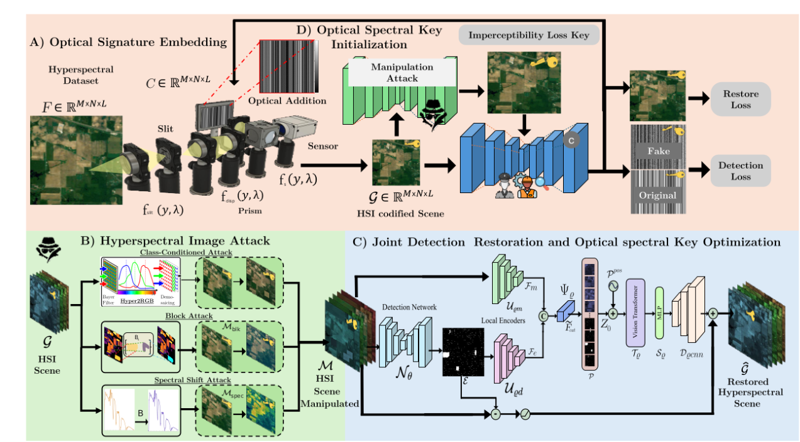

<div align="center">

# Spectral Authenticity System
### Optically Authenticated Hyperspectral Imaging
**Detection and Restoration of Manipulated Data**

[](https://doi.org/10.1109/TGRS.2026.3697764)


**Optical signing → Manipulation detection → Spectral restoration**

[Overview](#overview) · [Quick start](#quick-start) · [Datasets](datasets/README.md) · [Citation](#paper--citation)



</div>

## Overview

Hyperspectral images carry rich spectral information, but targeted alterations can compromise their reliability. The paper introduces an authentication framework that embeds an additive optical key in the light path of a pushbroom imager **before digitization**, then uses learned detection and restoration networks to locate manipulated pixels and recover spectral signatures.

| Stage | Purpose |
| :--- | :--- |
| **Sign** | Embed an optical key during acquisition while preserving useful spectral information. |
| **Detect** | Estimate the key and build an error map to identify spectral manipulation. |
| **Restore** | Use the manipulated cube and error map to reconstruct spectral information. |

### Results reported in the paper

The article reports up to **97% detection accuracy** under light perturbation, **above 92%** at 80% manipulation, restoration within **0.9°–1.3° SAM**, and classification performance within **0.6%–1.2%** of unsigned data. These are published experimental results, not measurements from this repository update.

### Implementation scope

This repository imports the research code supplied in `SA-main (1).zip`. Its entry point jointly optimizes a learnable spectral key, an autoencoder detector, and a U-Net restoration network.

**This snapshot is not a complete reproduction package for every published experiment.** `TGRS.py` initializes the key with uniform random values (`torch.rand * 0.2`); the paper additionally describes a variance-aware key design. Full attack-rate sweeps, baseline comparisons, laboratory acquisition control, and pretrained weights are not supplied as a complete executable workflow. The original training algorithm is preserved.

## Quick start

### 1. Clone

```bash
git lfs install
git clone https://github.com/pablogomezt/Spectral_Authenticity_System.git
cd Spectral_Authenticity_System
git lfs pull
```

### 2. Create the environment

```bash
conda env create -f environment.yml
conda activate ramon_env
python -c "import torch; print('CUDA available:', torch.cuda.is_available())"
```

The script explicitly requires CUDA. See [setup instructions](SETUP_ENVIRONMENT.md).

### 3. Prepare data and train

Follow the [dataset guide](datasets/README.md). The `.mat` files must contain real MATLAB data rather than Git LFS pointers. Run commands from the repository root.

```bash
python TGRS.py --dataset salinas --epochs 50 --beta 10.0 --lambda_ 10.0 --eta 0.1
```

For a short training check after preparing dependencies and data:

```bash
python TGRS.py --dataset salinas --epochs 2 --max_signatures 500
```

## Experiment options

| Argument | Default | Meaning |
| :--- | :--- | :--- |
| `--dataset` | `salinas` | `salinas`, `indian_pines`, `pavia`, `circular`, `cuadrada` |
| `--epochs` | `50` | Training epochs |
| `--max_signatures` | `1000` | Maximum selected signatures per class |
| `--number_steps` | `1` | Optimization steps per epoch |
| `--beta` | `10.0` | Detection loss weight |
| `--lambda_` | `10.0` | Restoration loss weight |
| `--eta` | `0.1` | Signing distortion loss weight |

```bash
python TGRS.py --dataset indian_pines --epochs 200 --beta 5.0 --lambda_ 15.0 --eta 0.05
python TGRS.py --dataset pavia --epochs 100 --beta 1.0 --lambda_ 20.0 --eta 0.2
```

These examples are not validated paper presets. The loader also contains `indian_pines_crop` and `multi`, but the entry point lacks wavelength settings for those names. Some parsed flags, including `--seed`, are not applied by the current training loop.

## Outputs

Runs write to `results/TGRS_{dataset}_epochs_{N}_beta_{b}_lambda_{l}_eta_{e}/`:

| File | Contents |
| :--- | :--- |
| `manipulated_{epoch}.png` | Signed, manipulated, and reference spectral signature plots |
| `key_mean_{epoch}.png` | Learned spectral key curve |
| `key.pt` | Latest learned key |
| `model_detection.pt` | Latest detector state dictionary |
| `model_recovery.pt` | Latest restoration network state dictionary |

Checkpoints are overwritten each epoch; plots retain their epoch number. Reusing the same run configuration can overwrite previous outputs. Results and checkpoints are ignored by Git.

## Repository map

```text
Spectral_Authenticity_System/
├── TGRS.py                 # Training entry point
├── models_2.py             # Detector and restoration architectures
├── losses.py               # Loss utilities
├── get_dataset.py          # MATLAB loading and normalization
├── models/                 # Auxiliary classifiers
├── scripts/                # Manipulation and visualization utilities
├── datasets/               # Data and format guide
├── pipelineSA.png          # Method overview
├── environment.yml         # Original Conda environment
└── SETUP_ENVIRONMENT.md    # Installation guide
```

## Troubleshooting

- **MATLAB loading fails:** check [dataset availability](datasets/README.md); LFS pointers are not MATLAB data.
- **CUDA unavailable:** use a compatible NVIDIA driver and CUDA-enabled PyTorch. CPU execution is not implemented.
- **GPU memory exhausted:** reduce `--max_signatures`; full-cube restoration still requires GPU memory.
- **Conda installation fails:** the environment is a platform-specific research export with exact builds, not a portable lockfile.

## Paper & citation

Pablo Gomez, Roman Jacome, Hans Garcia, Iñaki Esnaola, and Henry Arguello, **“Optically Authenticated Hyperspectral Imaging: Detection and Restoration of Manipulated Data,”** *IEEE Transactions on Geoscience and Remote Sensing*, vol. 64, article 5518710, 2026. [DOI: 10.1109/TGRS.2026.3697764](https://doi.org/10.1109/TGRS.2026.3697764).

```bibtex
@article{gomez2026optically,
  author = {Gomez, Pablo and Jacome, Roman and Garcia, Hans and Esnaola, Iñaki and Arguello, Henry},
  title = {Optically Authenticated Hyperspectral Imaging: Detection and Restoration of Manipulated Data},
  journal = {IEEE Transactions on Geoscience and Remote Sensing},
  volume = {64},
  year = {2026},
  doi = {10.1109/TGRS.2026.3697764}
}
```

## License and attribution

The supplied archive contains no license file. No software or dataset license is assigned by this update; contact the authors regarding reuse permissions. The publisher PDF is linked through the DOI rather than redistributed.
